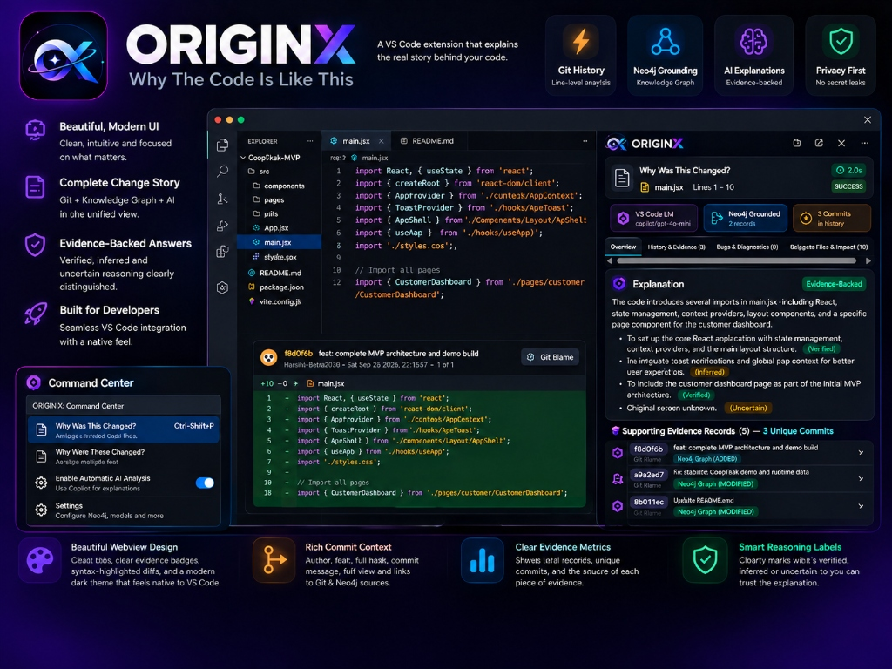

# GitWhisper by ORIGINX

Select a line in VS Code and ask **“Why is this code implemented this way?”** GitWhisper brings the relevant Git history, available pull requests and recorded design decisions into the editor. Open a citation to see what the author actually recorded. When the history does not explain a choice, Ask Why can report `INSUFFICIENT HISTORICAL EVIDENCE`.



## Try it on a function

1. Open a Git repository in VS Code and select a function in a source file.
2. Right-click and choose **GitWhisper: Understand & Continue**, or press **Ctrl+O, Ctrl+X** (**Cmd+O, Cmd+X** on macOS).
3. Press **Enter** to ask the suggested question, or type your own. Read the result in the GitWhisper sidebar and choose **Open Full Investigation** to inspect the supporting history and diagnostics.
4. To use the other tools, invoke **Understand & Continue** again and press **Esc** at the question. With the source editor active, the menu offers these four actions.

| Menu action | What you can inspect |
| --- | --- |
| **Explain Role & Impact** | The enclosing symbol, incoming calls and production or test references reported by the editor’s language provider. Without provider results, source parsing can still identify some symbols. An empty caller list leaves dynamic and unindexed calls unresolved. |
| **Multi-PR Function Evolution** | The Git history for a selected line range, with file history as a fallback. Labels such as “bug fix” come from commit subjects. A `#number` can refer to an issue, and the fallback PR link omits the repository name. Check the association in the repository before citing it. |
| **Audit PRD / Tasks vs Build** | Pick a Markdown or text file, or paste a checklist. The audit matches requirement keywords against up to 200 eligible files by default, including Markdown. A PRD can match its own wording. Treat the cited lines as leads and verify them against implementation and test output. The editor action does not run or import tests. |
| **Explain Code (What & How)** | A local summary of the selected lines, file and enclosing symbol when found. The editor notification shows the short summary and offers follow-ups for historical rationale and impact. |

## Historical evidence and handoffs

Ask Why can follow a file to commits and linked pull requests in an indexed Neo4j database. When graph evidence is unavailable, it can use local Git and repository documents. Previously recorded decisions can appear as provisional or superseded. Use the cited decision or change to check that status. **Save Context** and **Resume Context** keep handoffs under `.gitwhisper/checkpoints/`.

For optional Neo4j access, set `originx.neo4jUri` and `originx.neo4jUsername` for your database. From **Understand & Continue**, open **History, graph and settings… → Manage Neo4j credentials** to store a password in VS Code SecretStorage and test the connection. **Import Git history** writes to the configured graph.

Ask Why can send your question, code selection and retrieved evidence to an available VS Code language model. If the model is unavailable, it can assemble an answer from recorded evidence locally. The separate `originx.enableAutomaticAnalysis` setting defaults to off.

## Build and install this version

The four menu actions above were added in commit `02ae045`. Both this source and the earlier package carry version `0.3.6`. Use the commit to identify the build. [Implementation commit](https://github.com/Harshit-Batra2008/ORIGINX/commit/02ae04544a3b55294b274ea9b42ae65a1a3d3808)

The extension declares support for VS Code 1.85 or newer. For a source build, clone this repository and run these commands from its root with Git, npm and Node.js 22 or newer.

```sh
npm ci
npm run compile
npm test
```

To run from source, open the checkout in VS Code, choose **Run ORIGINX Extension (Compile only)** in Run and Debug and press **F5**. Open a Git repository in the Extension Development Host window. To build a standalone package from the same checkout, run this command.

```sh
npx --yes @vscode/vsce@4.1.1 package --out ../gitwhisper-code-intelligence-02ae045.vsix
```

In VS Code’s Extensions view, open **… → Install from VSIX…** and select the file you just built. The older local archive named `originx-extension-0.3.6.vsix` has none of the four new commands in its manifest.

At `02ae045`, `npm test` compiled the extension and reported **304 passed, 0 failed**. Seven tests cover the new services. Opening the installed extension and following its citations is a separate check. [New service tests](src/test/integratedIntelligenceTests.ts)

## Marketplace activity

ORIGINX reports **74 acquisitions** and **21 page views** on the first day after upload. The Marketplace publisher dashboard shows those totals with the 30-day filter selected. These figures measure distribution. Active usage and retention require separate measurements.
