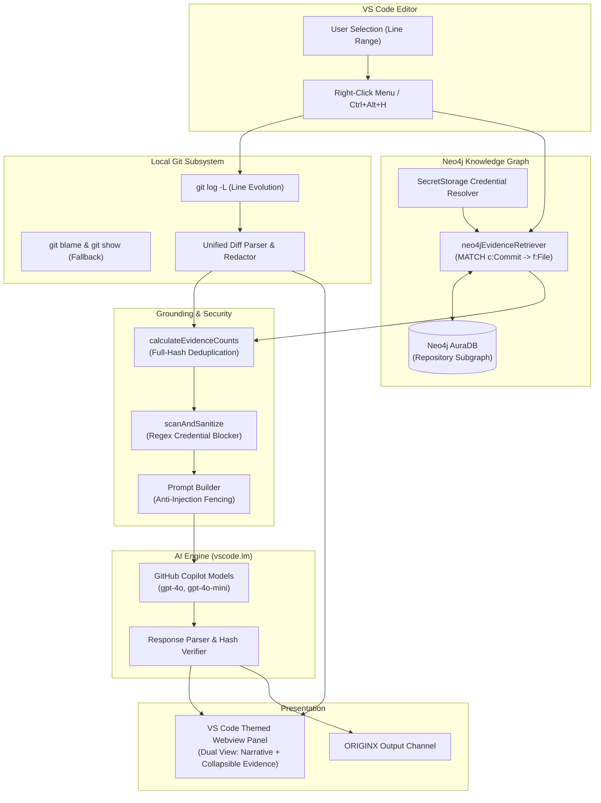

# GitWhisper by ORIGINX: Why The Code Is Like This

> **hackFront India 2026 Prototype**  
> **Problem Statement PS T1.1: “Why The Code Is Like This”**  
> **GitWhisper by ORIGINX** — An AI-powered VS Code extension providing evidence-grounded code history explanations by combining local Git line evolution with Neo4j Knowledge Graph provenance, natively driven by GitHub Copilot (`vscode.lm`).

[](https://www.typescriptlang.org/)
[](https://code.visualstudio.com/)
[](https://neo4j.com/cloud/platform/aura-graph-database/)
[]()
[](LICENSE)


---

## Executive Summary

Software engineering often answers *what* code does through comments and syntax, but rarely captures *why* it was written that way. When debugging legacy systems, reviewing pull requests, or onboarding onto unfamiliar repositories, developers spend hours wading through Git blame, PR discussions, and fragmented commit histories to reconstruct architectural intent.

**GitWhisper** (by team **ORIGINX**) solves problem statement **PS T1.1 (“Why The Code Is Like This”)** by turning code archaeology into a fast, transparent, and evidence-grounded experience:
1. **Local Git Line Evolution**: Pinpoints exact commit hunks, timestamps, authors, and diffs for any selected code lines.
2. **Neo4j Knowledge Graph Provenance**: Cross-references repository-level file modifications, commit relationships, and author networks stored in Neo4j AuraDB.
3. **Copilot-Native AI Synthesis**: Synthesizes verified change narratives using VS Code's native Language Model API (`vscode.lm`), strictly distinguishing verified facts from plausible inferences and stating `"Original reason unknown"` when documentation is missing.
4. **Zero Third-Party Cloud Keys**: Operates entirely with native GitHub Copilot chat models (`gpt-4o`, `gpt-4o-mini`, `claude`) and local Git execution. No credit cards, external Gemini/OpenAI API keys, or leaked credentials.

---

## Architecture

ORIGINX connects the code editor, local version control, remote graph database, and native language models in a modular, secure pipeline:



### Component Breakdown
- **Git Retrieval Service (`src/git/gitService.ts`)**: Runs `git log -L` and `git blame --porcelain` via safe `child_process.execFile` without shell interpolation.
- **Neo4j Evidence Retriever (`src/neo4j/neo4jEvidenceRetriever.ts`)**: Executes read-only, parameterized Cypher queries scoped strictly by repository identifier (`repoId`), pulling historical commit dates, subjects, bodies, authors, and change types (`ADDED`, `MODIFIED`, `DELETED`, `RENAMED`).
- **SecretStorage & Security Manager (`src/security/secretManager.ts`)**: Safely persists Neo4j database credentials in VS Code's encrypted `SecretStorage`. Automatically purges legacy unencrypted keys on activation.
- **Credential Redaction & Security Fence (`src/neo4j/neo4jEnv.ts`, `src/gemini/geminiPrompt.ts`)**: Scans code and diffs with regex patterns for private keys, AWS tokens, GitHub PATs, and bearer tokens, blocking AI transmission if secrets are detected.
- **Evidence Deduplicator (`src/ui/webviewView.ts`)**: Reconciles local line-blame commits with Neo4j graph records by canonical full 40-character commit hashes, clearly differentiating total evidence records from unique commits.
- **Copilot Language Model Client (`src/lm/vscodeLmClient.ts`, `src/gemini/geminiExplainer.ts`)**: Interfaces dynamically with models registered under `vscode.lm.selectChatModels()`.

---

## How Git & Neo4j Evidence Ground Explanations

Large language models are prone to hallucinating plausible-sounding reasons for code changes. ORIGINX eliminates guesswork by enforcing strict evidence grounding:

1. **Multi-Source Evidence Aggregation**:
   - **Local Git Blame**: Provides precise, line-level diff hunks for the exact selected region.
   - **Neo4j Knowledge Graph**: Supplies historical context, parent commits, file rename lineages, and cross-commit relationships.
2. **Canonical Deduplication**:
   - In multi-source analyses, a single commit often appears in both line blame and repository graph history. ORIGINX deduplicates by full 40-character SHA-1 hash (with 7-character prefix collision guards), displaying accurate metrics (e.g. *“Supporting Evidence Records (9) — 5 Unique Commits”*).
3. **Structured Explanation Format**:
   - **What Changed**: Structural and syntactic summary strictly observed from diffs.
   - **Possible Reasons**: Architectural motivations classified as `[Verified]`, `[Inferred]`, or `[Unknown]`. If commit messages are non-descriptive (e.g. `"update"`, `"wip"`), it explicitly outputs **“Original reason unknown”**.
   - **Supporting Commits**: Real commit citations. The parser verifies cited hashes against retrieved evidence; hallucinated hashes are flagged immediately.
   - **Uncertainty & Limitations**: Explicitly notes uncommitted changes, truncated lines, or lack of architectural rationale.

---

## Key Features & User Interface

### 1. Unified Code Analysis (`Ctrl+O, Ctrl+X`) — PRIMARY ACTION
Select any block of code, press `Ctrl+O` followed immediately by `Ctrl+X` (or right-click and select **`GitWhisper: Analyze Code`**).
- **Five Dedicated Tabs**:
  - **Overview**: High-level explanation of code purpose, historical evolution, and uncertainty bounds.
  - **History & Evidence**: Direct Git blame commits, diff hunks, and Neo4j Knowledge Graph history.
  - **Bugs & Diagnostics**: Real-time language server compiler diagnostics, severity tags, and bug overlap detection.
  - **Related Files & Impact**: Historically coupled companion files identified through Neo4j co-change retrieval to prevent regression blast radiuses.
  - **Suggestions & Fixes**: Advisory patch recommendations explicitly labeled `[UNVERIFIED - SUGGESTED FIX]` with one-click "Copy Fix".

### 2. Review Working Tree Changes (`originx.reviewWorkingTree`)
Inspect staged and unstaged working tree modifications with automatic Neo4j co-change companion detection:
- Highlights files that historically change together with your currently modified files.
- Generates structured reviewer summaries with verification checklists before committing.

### 3. Investigate Bug (`originx.investigateBug`)
Diagnose tricky regressions with evidence-grounded causality:
- Accepts selected problematic code and an optional developer error message.
- Combines local diagnostics, Git diffs, and Neo4j co-changes into root-cause hypotheses and advisory fixes.

### 4. Focused Line Inspection & Multi-File Archaeology
Historical archaeology workflows remain accessible under the secondary Command Center section:
- **`ORIGINX: Why Was This Changed?`** (`Ctrl+Alt+H` / `Cmd+Alt+H`): Instant line-level blame and AI causality.
- **`ORIGINX: Why Were These Changed?`**: Multi-file explorer history and cross-file reasoning with token estimation.

### 5. GitWhisper Command Center (`Ctrl+Shift+P` -> `GitWhisper: Command Center`)
To maintain a clutter-free Command Palette, GitWhisper exposes a centralized QuickPick action hub:
- **PRIMARY ACTIONS**:
  - `GitWhisper: Analyze Code` (Ctrl+O, Ctrl+X)
  - `GitWhisper: Review Working Tree Changes`
  - `GitWhisper: Investigate Bug`
- **FOCUSED HISTORY ANALYSIS**:
  - `Explain Selected Code` (Why Was This Changed?)
  - `Explain Multiple Selected Files` (Why Were These Changed?)
- **DEVELOPER TOOLS & SETTINGS**:
  - `Enable / Disable Automatic AI Analysis`
  - `List Available AI Models`
  - `Inspect Outgoing AI Payload` (inspect JSON payload in side editor without sending)
  - `View Technical Diagnostics` & `Open Output Channel`
  - `Manage Neo4j Database Credentials`

---

## Configuration Settings

All options can be configured in VS Code Settings (`Ctrl+,` -> search `originx`):

| Setting | Default | Description |
|---|---|---|
| `originx.enableAutomaticAnalysis` | `false` | When `true`, automatically queries Copilot LM on selection. When `false` (default), displays instant local Git history without network transmission. |
| `originx.promptVariant` | `"compact"` | Prompt variant: `'compact'` minimizes tokens (<350 tokens); `'standard'` uses full prompt template. |
| `originx.showMultiFileConfirmation` | `true` | Displays token estimation and file count confirmation before multi-file analysis. |
| `originx.neo4jUri` | `"neo4j+s://f46dba8b.databases.neo4j.io"` | Connection URI for the Neo4j AuraDB instance. |
| `originx.neo4jUsername` | `"f46dba8b"` | Configurable database username (defaults to AuraDB instance user). |
| `originx.neo4jDatabase` | `""` | Target Neo4j database name (leave empty for default database). |
| `originx.neo4jExcludedDirectories` | `["node_modules", "dist", "build", "coverage", ...]` | Path segments excluded from graph ingestion. |

---

## Installation & Setup

### Option A: Install from VSIX Package (Recommended for Judges)
1. Download the pre-built `originx-extension-0.3.1.vsix` package.
2. In VS Code, open the Extensions view (`Ctrl+Shift+X` or `Cmd+Shift+X`).
3. Click the **`...`** (Views and More Actions) menu in the top right of the Extensions pane.
4. Select **Install from VSIX...** and choose `originx-extension-0.3.1.vsix`.
5. Ensure GitHub Copilot or GitHub Copilot Chat is installed and active in VS Code.

### Option B: Build & Run from Source
1. **Clone the repository**:
   ```bash
   git clone https://github.com/Harshit-Batra2008/ORIGINX.git
   cd ORIGINX
   ```

2. **Install dependencies**:
   ```bash
   npm install
   ```

3. **Compile TypeScript**:
   ```bash
   npm run compile
   ```

4. **Run the offline automated test suite**:
   ```bash
   npm test
   ```
   *(All 214 tests run completely offline without requiring network access or database credentials.)*

---

## How to Run the Demo

Follow these simple steps for a live demonstration:

1. **Launch Extension Development Host**:
   - Open the project in VS Code (`code .`).
   - Press **`F5`** (or Run -> Start Debugging). An `[Extension Development Host]` window will open.

2. **Configure AI & Neo4j (First-time setup)**:
   - In the Extension Development Host window, press `Ctrl+Shift+P` -> select **`GitWhisper: Command Center`**.
   - Choose **`Enable Automatic AI Analysis`** (allows Copilot LM queries on code selection).
   - Choose **`Manage Neo4j Database Credentials`** -> **`Test Neo4j Connection`** (or enter password if prompted; credentials are saved in VS Code's encrypted SecretStorage).

3. **Demo Scenario 1: Unified Code Analysis (Main Action)**:
   - Open any source file in a Git repository (e.g. `package.json` or `src/extension.ts`).
   - Select 2–10 lines of code.
   - Press `Ctrl+O`, then `Ctrl+X` (or right-click and choose **`GitWhisper: Analyze Code`**).
   - Explore all 5 tabs: Overview, History & Evidence, Bugs & Diagnostics, Related Files & Impact, and Suggestions & Fixes.

4. **Demo Scenario 2: Review Working Tree Changes**:
   - Make an unstaged modification in a tracked file.
   - Run Command Center -> select **`GitWhisper: Review Working Tree Changes`**.
   - Observe working tree diffs accompanied by coupled companion files from Neo4j co-change history.

5. **Demo Scenario 3: Investigate Bug**:
   - Select suspicious code lines.
   - Run **`GitWhisper: Investigate Bug`** and optionally supply an error symptom.
   - Review observed facts, hypotheses, and an advisory suggested patch marked `[UNVERIFIED - SUGGESTED FIX]`.

6. **Demo Scenario 4: Offline Resilience (No AI / No Database)**:
   - Run Command Center -> choose **`Disable Automatic AI Analysis`**.
   - Select code and run **`GitWhisper: Analyze Code`**.
   - Observe that full local Git history, diffs, authors, and commit messages render instantly without sending data over the network.

---

## Automated Test Suite

ORIGINX includes a comprehensive, 100% offline test suite validating all core subsystems:
- **Git Engine**: Standard & porcelain log parsing, line tracking, empty repositories, untracked files, uncommitted changes.
- **Security & Privacy**: Private key detection, AWS key redaction, PAT redaction, SecretStorage purge migrations, payload sanitization.
- **AI Explainer & Prompts**: Prompt injection defenses, multi-section parsing, hallucinated hash detection, compact prompt bounds (<350 tokens).
- **VS Code Language Model Client**: Model discovery, error category mappings, token cancellations, streaming response assembly.
- **Reviewer & Co-Change Engine**: Working-tree change aggregation, Neo4j co-change graph retrieval, blast radius detection.
- **Bug Investigation Engine**: Diagnostics extraction, line mapping, symptom incorporation, unverified fix safeguards.
- **Unified Analysis Engine**: Unified evidence gathering, 5-tab webview rendering, safe HTML escaping, fallback error rendering.
- **Neo4j Knowledge Graph**: Path normalization, name-status parsing, repository namespacing, idempotent MERGE queries, repository-scoped evidence retrieval.

```text
====================================================
Test Results: 214 passed, 0 failed
====================================================
```

---

## Current Limitations

- **VS Code Language Model API Dependency**: AI synthesis requires an active language model provider in VS Code (e.g., GitHub Copilot extension active with access to `copilot/gpt-4o` or `copilot/gpt-4o-mini`). When unavailable, ORIGINX gracefully falls back to complete local Git history.
- **Line Evolution Bounded Range**: To ensure responsive editor performance, line-level Git history traces are bounded to recent commits.
- **Graph Ingestion Scope**: Ingestion into Neo4j AuraDB captures commit metadata, file modifications, and author attribution; actual code diff contents are kept local to respect repository privacy.

---

## License

This project is licensed under the [MIT License](LICENSE).
